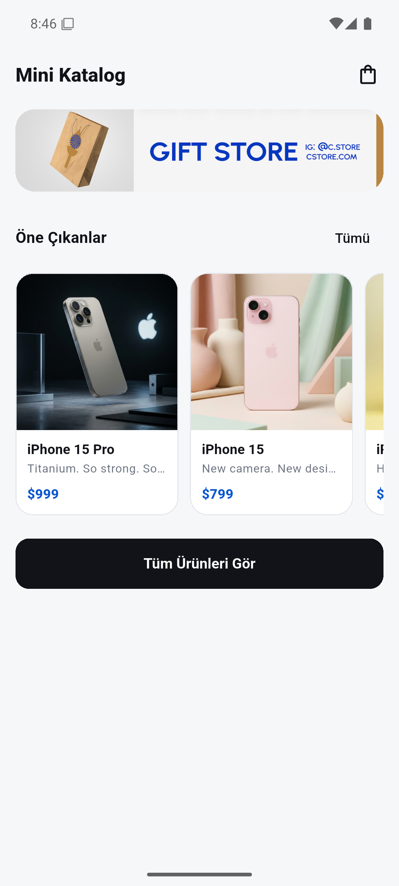
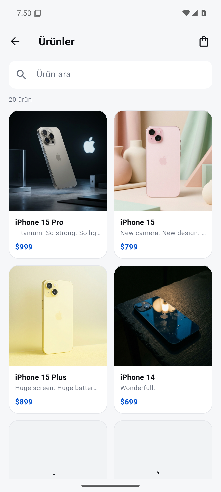

# Mini Katalog

Flutter ile geliştirilmiş mini katalog uygulaması. Ürünler canlı JSON kaynağından okunur; ana sayfa, ürün listesi, ürün detayı ve sepet ekranları içerir.

Ürün verileri `https://wantapi.com/products.php` adresinden alınır. Sepet işlemleri uygulama içinde tutulur.

## Özellikler

- Ana sayfada banner ve öne çıkan ürünler
- GridView tabanlı ürün listesi
- Ürün adına göre arama
- Ürün detayında görsel, fiyat, açıklama ve özellikler
- Ürün detayına route arguments ile geçiş
- Sepete ürün ekleme
- Sepette adet artırma/azaltma, ürün silme ve sepeti temizleme
- Sepet toplam tutarı ve ürün sayısı
- Yükleniyor, hata ve boş liste durumları

## Teknolojiler

- Flutter 3.47.9
- Dart 3.13.7
- `material.dart`
- Ek paket kullanılmadı

## Gereksinimler

- Flutter SDK
- Android emülatör veya fiziksel Android cihaz
- iOS derlemesi için macOS ve Xcode
- Ürün verileri için internet bağlantısı

## Kurulum

```bash
flutter pub get
```

## Çalıştırma

```bash
flutter run
```

## Proje Yapısı

```text
lib/
  components/   ortak arayüz bileşenleri
  models/       ürün ve sepet modelleri
  services/     ürün verisi servisi
  state/        katalog ve sepet durumu
  theme/        uygulama teması
  utils/        fiyat biçimlendirme
  views/        ana sayfa, ürün listesi, detay ve sepet
  main.dart
test/           birim testleri
assets/images/  banner görseli
```

## Veri Kaynağı

Ürün listesi `wantapi.com/products.php` adresinden JSON olarak alınır. Görsel adresleri ürün verisiyle birlikte gelir. Ana sayfadaki banner `assets/images/banner.png` dosyasından yüklenir.

## Test

```bash
flutter analyze
flutter test
```

Projede ürün modeli, API servisi, sepet durumu ve fiyat biçimlendirme için toplam 13 test bulunur.

## Ekran Görüntüleri






## GitHub Deposu

https://github.com/samil07kocakavuk/mini-katalog

## Notlar

- Ürün verisi canlı kaynaktan geldiği için internet bağlantısı gerekir.
- Bağlantı hatasında hata ekranı ve yeniden deneme seçeneği gösterilir.
- iOS platform iskeleti projede bulunur; derleme için macOS ve Xcode gerekir.
