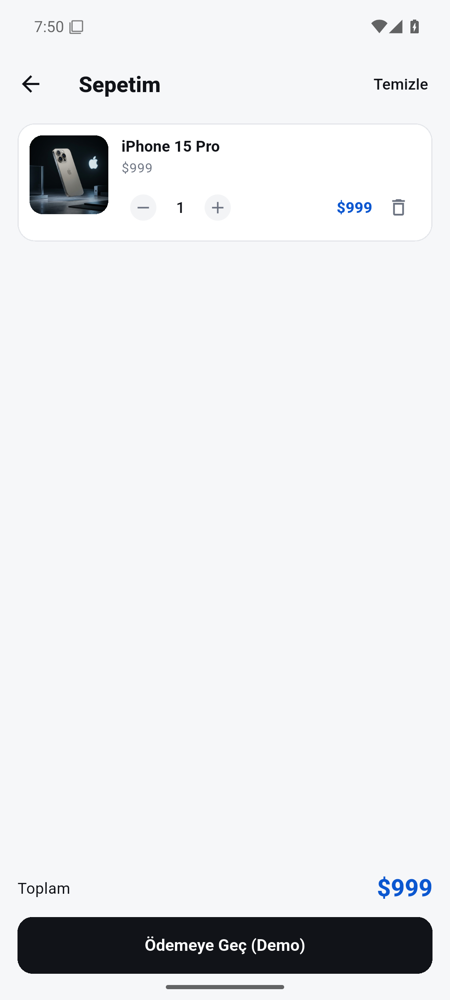

# Mini Katalog

Flutter ile geliştirilmiş, ürünleri canlı bir JSON kaynağından okuyan demo
mobil katalog uygulaması. Eğitim projesi kapsamında ana sayfa, ürün listesi,
ürün detayı ve sepet simülasyonu içerir.

## Özellikler

- Canlı ürün verisi: `https://wantapi.com/products.php`
- Ana sayfa: banner, öne çıkan ürünler ve ürün listesine geçiş
- Ürün listesi: iki sütunlu grid, arama ve aşağı çekerek yenileme
- Ürün detayı: görsel, açıklama, dinamik özellikler ve sepete ekleme
- Sepet: adet artırma/azaltma, ürün kaldırma, toplam tutar ve badge
- Hata, yükleniyor ve boş durum ekranları
- Responsive kart yapısı ve Material 3 teması

## Kullanılan Flutter sürümü

- Flutter 3.47.9 (stable)
- Dart 3.13.7

## Çalıştırma

```bash
flutter pub get
flutter run
```

Android cihaz/emülatör için Android SDK ve USB hata ayıklama (veya emülatör)
gereklidir. Uygulama internet izni ile gelir ve ürünleri çalışma anında
`wantapi.com` üzerinden çeker. Projede iOS platform iskeleti de bulunur;
iOS derlemesi için macOS ve Xcode gerekir.

Cihazda görünen uygulama adı: **Software Persona E-Commerce**.

## Doğrulama

```bash
flutter analyze
flutter test
```

## APK üretimi

```bash
flutter build apk --release
flutter build apk --release --split-per-abi
flutter build appbundle --release
```

Çıktı: `build/app/outputs/flutter-apk/app-release.apk`

## Ekran görüntüleri

Ekran görüntüleri `docs/screenshots/` klasöründedir:

- `01-home.png` — Ana Sayfa
- `02-products.png` — Ürün Listesi
- `03-detail.png` — Ürün Detayı
- `04-cart.png` — Sepet




## Proje yapısı

```text
lib/
  main.dart
  models/        Product, CartItem
  services/      ApiService
  state/         CatalogController, CartController, AppScope
  theme/         AppTheme
  utils/         fiyat formatlayıcı
  views/         Home, ProductList, ProductDetail, Cart
  components/    ProductCard, CartIconButton, ErrorView
```

## Notlar

- Bu proje eğitim/demo amaçlıdır; gerçek ödeme veya sipariş işlemi yapmaz.
- Ürün verileri ve banner görseli `wantapi.com` üzerinden temin edilmiştir.
- Ağ hatasında liste ekranında tekrar deneme ve yenileme desteği bulunur.
